<!-- ═══════════════ HEADER ═══════════════ -->

## 🛠️ Toolbox

| Layer | Stack |
|:-----:|:------|
| **📱 Mobile** |  |
| **⚡ Embedded** |   |
| **🌐 Web** |  |
| **☁️ Backend & Data** |  |
| **🧩 Languages** |  |
| **🛡️ Security** |    |
| **🐧 Environment** |  |

 

## 🔭 Currently

| | |
|:--|:--|
| 🛡️ **Exploring** | Web application security through PortSwigger Web Security Academy |
| 🌐 **Deepening** | Full-stack fundamentals with React and Node / Express |
| ☁️ **Curious about** | Backend architecture, cloud, and how to secure it all |
| 🎯 **Looking for** | A team where I can contribute meaningfully and build great products. |

 

## 📊 GitHub Snapshot

